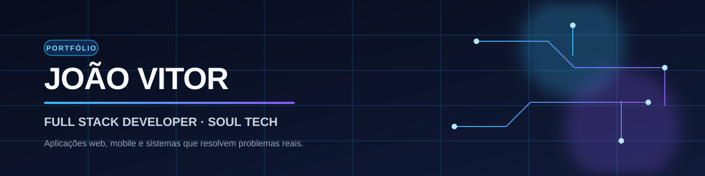

  

  
  
  
  

## Olá! Eu sou o João Vitor 👋

Crio **sites, aplicações web, apps e sistemas sob medida** para transformar ideias em produtos úteis. Sou estudante de **Ciência da Computação na UNIMAR** e cofundador da **Soul Tech**, em Marília-SP.

- Foco em arquitetura de sistemas, boas práticas e experiências rápidas.
- Estudando Data Science, TinyML, automação e backend com Rust.
- Disponível para projetos e parcerias.

---

### 🚀 Tecnologias & Ferramentas

**Front-End & Mobile**

  

**Back-End & Dados** *(em aprendizado)*

  

---

### 📊 Linguagens mais usadas

  

---

### ✨ Projetos em destaque

| Projeto | O que é | Stack e links |
| --- | --- | --- |
| **F.O.G.O.** | Ferramenta Onisciente de Gestão e Operações, criada para o DSIN Coder Challenge 2026. | `TypeScript` · [Código](https://github.com/JvbsB7/fogo-dsin) |
| **Jungle Gaming** | Interface de marketplace de NFTs criada como desafio de front-end. | `TypeScript` · [Demo](https://frontend-challenge-jungle-gaming-eight.vercel.app) · [Código](https://github.com/JvbsB7/frontend-challenge-jungle-gaming) |
| **Dragon Universe** | Site oficial de um add-on de fãs para Minecraft Bedrock. | `TypeScript` · [Demo](https://jvbsb7.github.io/DragonUniverseWebSite/) · [Código](https://github.com/JvbsB7/DragonUniverseWebSite) |

---

### 🤝 Vamos construir algo juntos?

Na **[Soul Tech](https://soultech.agency)**, desenvolvemos produtos digitais com foco em performance, design e resultado para o negócio. Conheça o **[meu portfólio](https://me-joao.soultech.agency/)** ou fale comigo pelo **[LinkedIn](https://www.linkedin.com/in/jo%C3%A3o-vitor-417696261)**.
